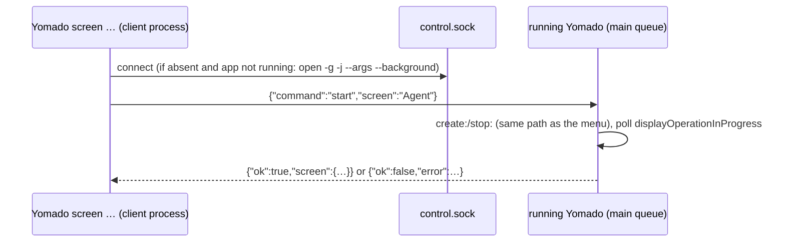

# Fork features

Customizations this fork carries on top of `chekusu/yomado`. Each feature lists where it touches upstream files so a rebase can re-check them.

The `main` branch contains screen control. Computer use—background input and capture, agent sessions, the REPL, and JS/Python clients—is maintained on the [`computer-use` branch](https://github.com/mouriya-s-lab/yomado/tree/computer-use).

## control: `Yomado screen …`

Manages named virtual screens from the command line: `list`, `create`, `start`, `close`, `rename`, `configure`, `delete`. User-facing behaviour is documented in the main README under "Control screens from the command line".

Why it lives in the app binary: a virtual display belongs to the process that created it, so screens can only be created and removed inside the running app. The CLI is a client that sends one JSON request over `~/Library/Application Support/dev.chekusu.yomado/control.sock` (mode 0600, directory 0700) and prints the JSON reply.

Files:

- `fork-features/control/YMControl.{h,m}`: request type and validation, socket server, CLI client.
- `app/Yomado.m`, marked `fork:`:
  - imports `YMControl.h`;
  - adds the `controlServer` and `controlRequestActive` properties;
  - `applicationDidFinishLaunching:` starts the server and skips `showWindow:` under `--background`;
  - `reportTopologyError:` and `reportApplicationError:` show no alert while a CLI request is active, and the reply carries their text instead;
  - `addDisplay:` now shares `appendProfileNamed:width:hiDPI:` with `screen create`;
  - `applicationWillTerminate:` closes the socket;
  - the `ADController (YMControl)` category at the end of the file implements the request handler;
  - `main()` routes `screen` to the client.
- `build.sh` and `scripts/test-controller-safety.sh`: add the include path and `YMControl.m`.
- Docs: `README.md`, `README.zh-CN.md`, `skills/yomado/SKILL.md`.

Rebase check: if upstream adds its own scripting or control interface, migrate to it and drop this feature. Otherwise re-verify on the installed build that `screen create/start/close` change `aerospace list-monitors` (or System Settings → Displays) without showing the panel, and that `close` refuses with a reason while a window remains on the screen and Accessibility permission is off.
