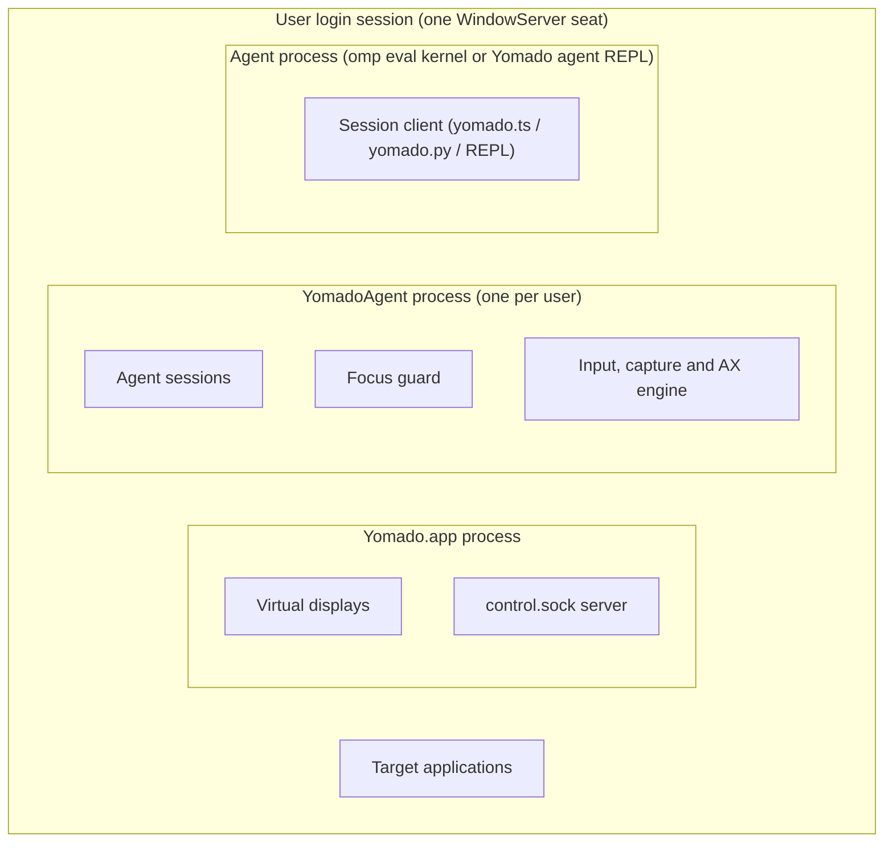
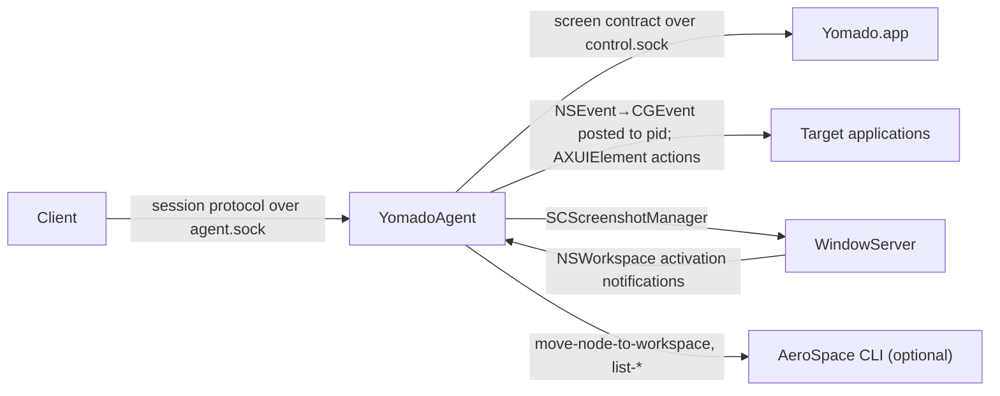

# Agent sessions

This node designs the **agent session**: the way an AI agent operates GUI applications on a yomado virtual screen without using the user's pointer, keyboard focus or front application. It owns the session model, the helper process, the session protocol, and the two client forms (REPL and code mode).

It does not own virtual screens. Screen lifecycle belongs to the control feature (`fork-features/README.md`, section "control"); this node only requests screens through that feature's `screen` contract. It also does not own AeroSpace configuration or the agent's skill text (`skills/yomado/SKILL.md` describes how an agent uses this node).

Non-goals:

- An independent hardware input seat. macOS has one key window per login session, so a session cannot give an agent a second physical pointer or keyboard.
- Isolation between the user and an agent inside one application process. When both operate windows of the same process, they share that process's focus state.
- Moving windows that the agent did not launch or explicitly adopt.

## Problem

### Domains

| Domain | Properties we cannot design (evidence) |
|---|---|
| WindowServer and AppKit input | One key window and one front application per login session. `CGEventPostToPid` delivers an event to one process without changing the front application. Measured on macOS 27.0.1: SwiftUI controls accept a background click only when the event is built by `NSEvent mouseEventWithType:…windowNumber:`, converted with `-CGEvent`, and given a window-local point by `CGEventSetWindowLocation`. A bare `CGEventCreateMouseEvent`, with or without fields 91/92, subtype 3 or Command, is ignored. Keyboard events posted to a process reach its key window. |
| Target applications | An application can activate itself in response to input, a launch or a modal sheet. Activation is visible to the user and redirects the user's typing. |
| TCC | Accessibility and Screen Recording grants belong to the *responsible process*. A process spawned by a granted process inherits that responsibility. Measured: a helper spawned detached from the omp eval kernel reported `AXIsProcessTrusted=1` and captured a window through ScreenCaptureKit. |
| ScreenCaptureKit | `SCContentFilter(desktopIndependentWindow:)` captures an occluded or off-screen window; a minimized window pauses (WWDC22 10155). |
| AeroSpace (optional) | AeroSpace assigns every window to a workspace and every workspace to a monitor; a workspace that is not visible keeps its windows off-screen. `aerospace move-node-to-workspace --window-id` moves one window without switching the user's workspace. |
| yomado screen control | `Yomado screen start/create` returns a running, verified virtual display with a `displayID`. |

### Requirements

- R1. An agent operates applications on its virtual screen while the user keeps working: the user's front application, key window and pointer do not change because of agent input.
- R2. If a target application activates itself, the user's front application is restored and the agent is told.
- R3. An agent can see what it operates: window and screen images, and the actionable accessibility elements of a window.
- R4. Agents use the session from omp `eval` (JS and Python kernels) by importing a library and calling it across many cells, and from an interactive line REPL.
- R5. Several agents can hold sessions at the same time without corrupting each other's state.
- R6. No manual setup step for the user beyond grants the agent's own tool already holds.

### Quality scenarios

| ID | Stimulus | Response measure |
|---|---|---|
| Q1 | An agent posts 100 clicks and 1,000 characters to a background application while the user types in another application | The user's front application pid and focused window id are equal before and after every request; no user keystroke reaches the agent's application. |
| Q2 | A target application activates itself during an agent request | The user's front application is front again within 200 ms of the activation notification; the response carries `focus_stolen`. |
| Q3 | Two agents send requests concurrently | Each request completes with the same result as when sent alone; no request observes another session's windows. |
| Q4 | An eval cell calls `capture` | A PNG of the window is on disk within 500 ms for a 2560×1440 window. |

## Architecture

### Definitions

- **Agent session.** A session is a lifetime in the helper that starts when a client connection sends `open` and ends when that connection closes. A session is bound to one yomado screen and owns a set of windows.
- **Owned window.** An owned window is a window that a session launched or adopted and has not handed off. A window has at most one owner session. Only a session's owned windows accept that session's input, capture and accessibility requests.
- **Agent application.** An agent application is a process that has at least one owned window in some session. The focus guard protects the user against agent applications only.
- **Virtual pointer.** A virtual pointer is a per-session record of a window id and a window-local point. It is never the system pointer. Pointer operations update it; `capture` draws it.
- **Element reference.** An element reference is a session-local name (`e1`, `e2`, …) for an accessibility element of an owned window. References from one `ax` call stay valid until the next `ax` call for the same window or until the window closes.
- **User front application.** The user front application is the most recent front application that is not an agent application.

### Parts and containment

Process/host containment:

| Part | Designed in | Start | End |
|---|---|---|---|
| Virtual displays, `control.sock` | control feature | Yomado launch / `screen start` | `screen close` / Yomado quit |
| YomadoAgent process | this node | First client finds no `agent.sock` and spawns it | 60 s after its last session ends |
| Agent session | this node | `open` request | Client connection closes |
| Session client | this node | Agent imports it or starts the REPL | Agent process exits or calls `close()` |

Lifecycle: a session exists only inside a YomadoAgent process; owned windows, element references and the virtual pointer exist only inside their session. When a session ends, its windows stay where they are and stop being owned; the agent quits its applications before ending the session when it wants them gone.

### Interactions

- **Session protocol** (this node, [Session protocol](#session-protocol)): clients send requests; the helper answers each request once.
- **Screen contract** (control feature): the helper calls `start`, `create` and `list` like any other client.

### Decisions

**D1. One helper process owns all sessions.** The helper is the only authority for owned windows, element references, virtual pointers and the focus guard. Because the focus guard compares activations against one record of the user front application, two guards in two processes would each restore a different application (R2, R5).
The helper is a nested bundle, `Yomado.app/Contents/Helpers/YomadoAgent.app`, with its own bundle identifier `dev.chekusu.yomado.agent`. Because LaunchServices registers an AppKit process whose executable lies in `Yomado.app/Contents/MacOS` as Yomado itself, a helper there makes `open -a Yomado.app` treat Yomado as running and not launch it.
Alternatives: the engine inside Yomado.app; rejected because an engine fault or a hung accessibility call would end the process that keeps the virtual displays alive, and because it enlarges the fork's changes to upstream `app/Yomado.m`. The engine inside each client library; rejected because each eval kernel would run its own guard (conflicting restores) and because Python would need a second engine.
Revisit when: upstream yomado adds an agent input facility.

**D2. The helper inherits the client's TCC grants.** A client spawns the helper with `posix_spawn` from the agent process, so the helper's responsible process is the agent's tool (terminal or omp), which already holds Accessibility and Screen Recording (R6). The helper has no grants of its own and needs no stable code signature.
Alternative: a stable self-signed identity plus one-time grants for YomadoAgent; rejected for now because ad-hoc rebuilds would drop the grants and the user would have to grant again.
Revisit when: agents run from a tool without those grants, or the helper must outlive every granted tool across a logout.

**D3. Requests execute one at a time, in arrival order, on the helper's main thread.** Serial execution makes concurrent sessions safe without locks (Q3), and keeps the focus guard's "before" and "after" observations attributable to one request (R2). Waiting inside a request (launch, capture, settle) dispatches AppKit events and run-loop sources, so activation notifications, completion handlers and display changes still arrive, but the helper starts no other request until the current one has answered.

**D4. Input uses the measured background recipe and nothing global.** Clicks, drags and scrolls are built as AppKit events for the target window, given window-local points, and posted to the target pid. Keys and text are posted to the target pid from a session-private `CGEventSource`, so a session's modifier state never mixes with the user's. Accessibility actions are used for `press` and `set`. The helper never calls `CGEventPost`, never warps the system pointer, and never activates a target (R1).
Revisit when: a target ignores this recipe; the agent then hands the window off to the user instead of the helper using global input.

**D5. The focus guard restores and reports.** Every activation of an agent application while the user front application is not an agent application is undone with `-[NSRunningApplication activateWithOptions:]` on the user front application, and is reported as an event. If it happened during a request, that request fails with `focus_stolen` (R2, Q2). Applications whose windows are handed off are not agent applications, so the user can work in them.

**D6. Placement uses AeroSpace when it runs, Accessibility otherwise.** With AeroSpace, an owned window moves to the workspace visible on the session's monitor. Without AeroSpace, the window's position is set into the screen's bounds. New windows of agent applications are adopted at the start of every request and by a sweep every 1 s, so dialogs that open elsewhere return to the agent screen. A result reports a window's bounds only after the move has reached the screen (3 s limit).

**D7. Sessions are connection-scoped.** A session ends exactly when its connection closes, so a crashed or reset eval kernel leaves no session behind and the helper needs no lease or heartbeat.

## Session protocol

Transport: a Unix stream socket at `~/Library/Application Support/dev.chekusu.yomado/agent.sock`, mode 0600, directory 0700. Each message is one JSON object followed by `\n`, in UTF-8.

| Item | Rule |
|---|---|
| Participants | Provider: YomadoAgent (this node). User: a session client (this node). |
| Exchange | Request `{"id": int, "op": string, …arguments}`. Response `{"id": int, "ok": true, "result": object, "events": [event]}` or `{"id": int, "ok": false, "error": {"code": string, "message": string}, "events": [event]}`. Operations and arguments: [operations.md](operations.md). |
| Preconditions | The first request on a connection is `open` or `status`. A request names only owned windows, except `adopt`. |
| Guarantees | Exactly one response per request, with the request's `id`, in request order. Every `events` entry is delivered once, on the next response of the session it concerns. Requests from all sessions execute serially (D3). The user front application, key window and system pointer are not changed by a successful request. |
| Errors | `usage`, `not_open`, `no_screen`, `no_window`, `not_owned`, `app_running`, `launch_failed`, `ax_failed`, `stale_ref`, `capture_failed`, `focus_stolen`, `permission`, `timeout`, `yomado_unreachable`. Meanings: [operations.md](operations.md#errors). |
| Failure semantics | Client disconnect: the session ends; requests already executing finish and their responses are dropped. Helper crash: every connection closes; sessions are lost; windows stay where they are; the next client spawns a new helper. Request timeout (any single wait exceeds 15 s): `timeout`, session continues. |
| Lifecycle | Connection open → `open` starts the session → connection close ends it. The helper starts on first spawn and exits 60 s after the last session ends. |
| Quality | Q1–Q4. |
| Not promised | Element reference format; image file names; event ordering across different sessions; delivery into applications that reject process-targeted events. |

Clients: the code-mode libraries expose one method per operation and return `result` or throw an error carrying `code`; they also expose received `events`. The REPL reads one request per line (the operation name followed by positional arguments, or a raw JSON object) and prints one response line. Client details: [clients.md](clients.md).

## Appendices

| File | Content |
|---|---|
| [operations.md](operations.md) | Every operation's arguments, result, errors; event types. |
| [clients.md](clients.md) | Code-mode library API (JS and Python) and REPL syntax; how the clients spawn the helper. |
